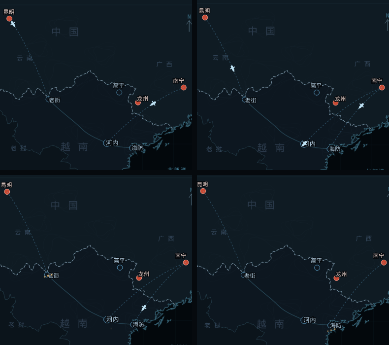

# 对越自卫反击战 1979 · 时空沙盒

一个单页的历史事件可视化：时间轴推演 + 真实底图的战场动画 + 双方战事全记录。

注：本作品由AI辅助生成，仅供参考，仅提供教学用途，无不良引导

打开 `index.html` 即可使用（建议 Chrome / Edge）。

## 内容

| 板块 | 说明 |
|---|---|
| 战前背景 | 1950—1979：从援越二十五年到边境流血，13 个节点 |
| 1979 战争 | 三阶段 12 个节点：突破边境 → 攻克谅山 → 交替回撤 |
| 边境十年 | 骑线制高点、法卡山、两山轮战、赤瓜礁海战，9 个节点 |
| 和解 | 1991 关系正常化 → 1999 陆地边界条约 → 2008 勘界完成 |
| 双方全记录 | 42 条对照表，同一时间点我军 / 越军各自在做什么 |
| 影响与数据 | 作战三阶段、双方作战指导、越军档案、兵力汇总、口径说明 |

## 推演（约 98 秒）

在「1979 战争」页点 **🎬 电影推演**。20 个镜头：援越空运 → 战略背景 → 双方言论 → 边境袭扰（越境埋雷、炮兵射击）→ 敌情 → 军委决策 → 炮火准备 → 双线突破 → 头版 → 安理会 → 国际棋盘 → 谅山 → 河内 → 撤军 → 回收与爆破 → 构筑防线 → 十年对峙 → 和解 → 尾声。

- 地图使用 Natural Earth 1:10m 边界数据，按真实经纬度投影
- 箭头沿实际行军路线（经水口、东溪、同登、柑塘等途经点）而非直线
- 越军炮位会转向、弹道按抛物线实时重算，落点有爆炸半径与碎片
- 撤军段显示原路回撤路线，以及此后沿边境构筑的防御线（红色虚线）

## 音乐

| 文件 | 用途 |
|---|---|
| `bgm.wav` | 推演音乐（南疆行） |
| `page-bgm.wav` | 页面背景音乐（雾里看史） |

页面右下角有一个唱片按钮，点击可开关页面音乐；推演开始时页面音乐自动停止，结束后自动恢复。

## 数据与口径

- 时间、地点取自公开史料；伤亡、兵力等数字标注了来源属性，不同来源差异很大
- 地图为示意性推演，使用 Natural Earth 公开边界数据，**不作为任何疆界依据**
- 「人民日报」版面为**复刻示意**（标题按当时行文重排），不是原件影印
